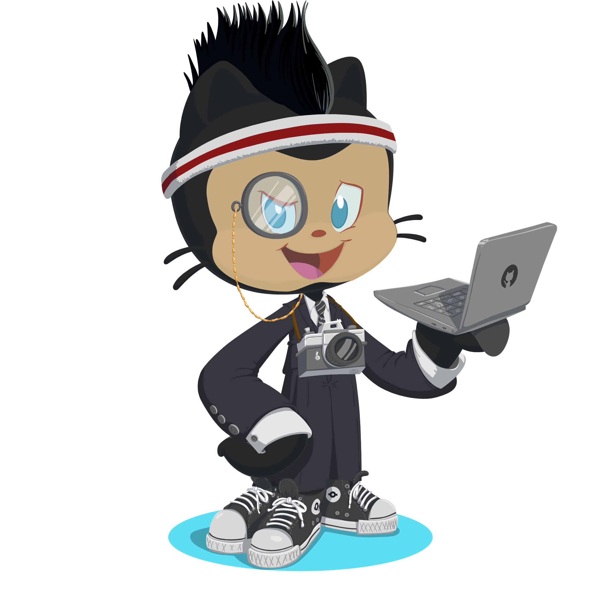

---

##  HI, I'M DEVTOCHUKWU *`dev (tow-chew-coo)`*

**Software Engineer (Frontend Heavy) | UI Specialist | Dev Support**

> *“I don't just build projects, I build products that work.”*

---

  

---

## 🚀 About Me

My name is Tochukwu, I am a first principle engineer, and founder.
I am a software developer, I build software on the web. I am proficient in JavaScript, Typescript, Rust, and Java.

When I am not squashing bugs, I love reading mind-building books, discussing philosophical topics, and being human.

I’m passionate about writing code that’s clean, understandable, and maintainable. I love getting under the hood and making things work—the right way.

I'm not where I want to be yet—but I'm putting in the reps, leveling up fast, and aiming to build scalable, secure, and elegant systems that people can rely on.

---

## 🧠 Core Tech Stack

&nbsp;

&nbsp;
\
&nbsp;

&nbsp;
&nbsp;\

&nbsp;

---

## 📡 Let's Connect

* 🔗 [GitHub](https://github.com/SimpleX-T)
* 💼 [LinkedIn](https://www.linkedin.com/in/devtochukwu)
* 🐦 [X (Twitter)](https://x.com/devtochukwu)
* 📬 [Email](mailto:ntmark2004@gmail.com)

---

*Always open to building, solving, and scaling—especially with other devs who love clean architecture and getting things done.* ✨

---

 
  
💻 GitHub Profile Stats

  

  <samp>
    <h2 align="center"> Github stats </h2>
       
    

  
<h3>Languages</h3>

            

            
      

        

          
          
        

    

  
<h3>statistics</h3>

        

          
          
       

      
     </samp>
  
    
 

---

 &nbsp;&nbsp;&nbsp;&nbsp;&nbsp;&nbsp;<a href="https://badges.layer5.io">Get your own badge</a>

My Octocat

<a href="https://myoctocat.com/gallery/" style="color: #ffc; text-decoration: none;">Make yours</a>

---
